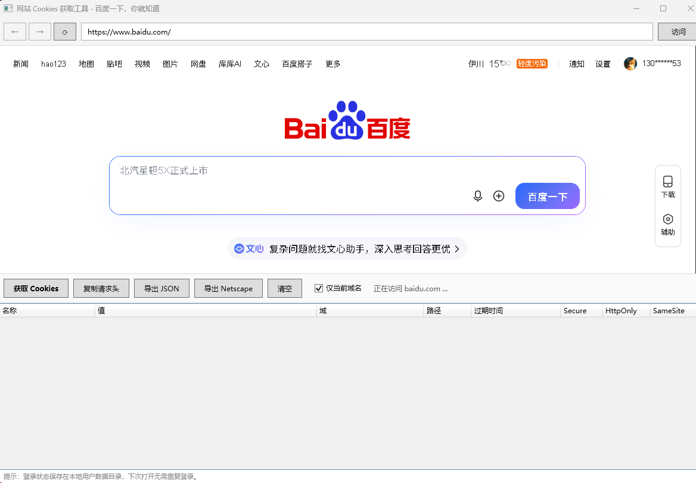

# CookieGrabber

网站 Cookies 获取工具 —— 一个基于 WPF + WebView2 的 Windows 桌面应用，可在内置浏览器中登录网站后，查看并导出当前会话的 Cookies。



## 功能

- 内置 WebView2 浏览器，登录状态持久化（下次打开无需重新登录）
- 一键获取当前会话的所有 Cookies，或仅筛选当前域名
- 展示 Cookie 详情：名称、值、域、路径、过期时间、Secure / HttpOnly / SameSite
- 导出为 JSON（`cookies.json`）或 Netscape `cookies.txt` 格式（可配合 curl、wget、yt-dlp 等工具使用）
- 一键复制为 HTTP 请求头格式（`name=value; name=value ...`）

## 下载

免安装版（自带 .NET 运行时，解压即可运行）：

> 前往 [Releases 页面](https://github.com/lyp689/CookieGrabber/releases) 下载 `CookieGrabber-win-x64.zip`，解压后双击 `CookieGrabber.exe`。

系统要求：Windows 10 / 11（需自带或安装 [Microsoft Edge WebView2 运行时](https://developer.microsoft.com/microsoft-edge/webview2/)，Windows 11 默认已内置）。

## 使用方法

1. 启动程序，在地址栏输入网址并登录目标网站
2. 点击「获取 Cookies」，可选勾选「仅当前域名」
3. 选择导出方式：复制请求头 / 导出 JSON / 导出 cookies.txt

## 从源码构建

需要 [.NET 8 SDK](https://dotnet.microsoft.com/download/dotnet/8.0)：

```bash
git clone https://github.com/lyp689/CookieGrabber.git
cd CookieGrabber
dotnet publish -c Release -r win-x64 --self-contained true -p:PublishSingleFile=true
```

产物位于 `bin/Release/net8.0-windows/win-x64/publish/`。

## ⚠️ 免责声明

本工具仅用于获取**你自己登录的账号**的会话 Cookies，便于开发调试、API 测试或个人数据备份。请勿用于获取、分享或滥用他人账号凭据，由此产生的一切后果由使用者自行承担。
